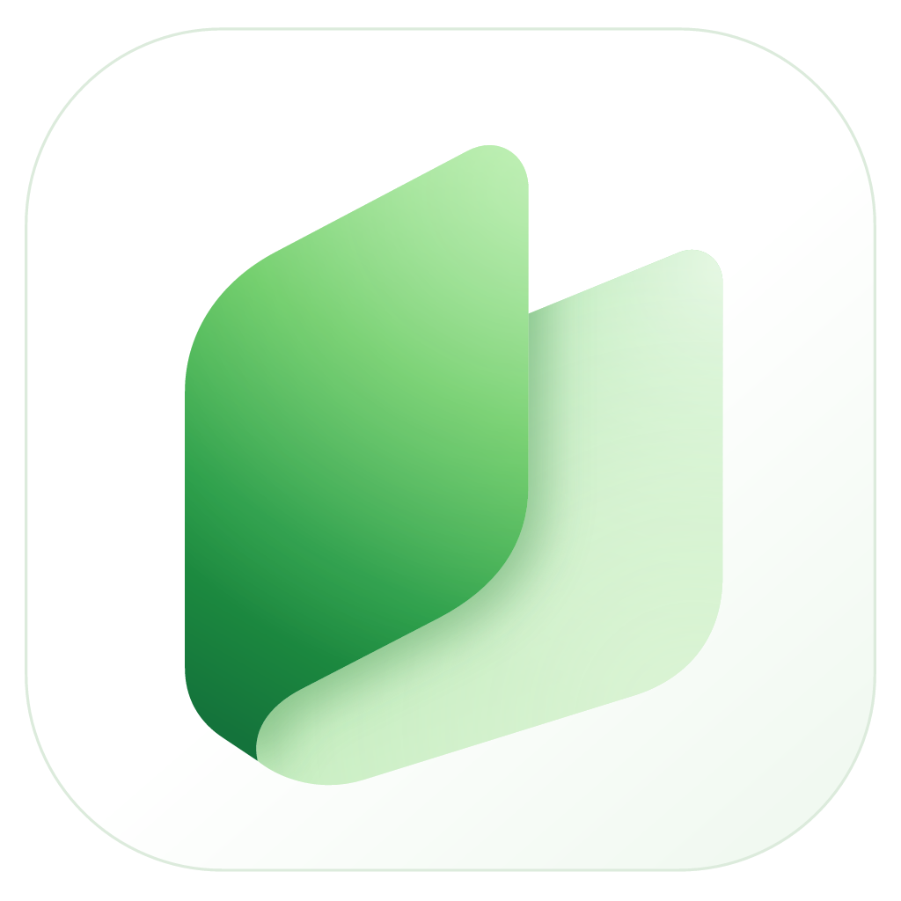

<div align="center">



# Tano / 同页

### Personas y agentes, en la misma página.

**Un espacio de trabajo donde las personas y los agentes de IA usan los mismos archivos reales.**

[English](README.md) | [简体中文](README_ZH.md) | [繁體中文](README_TW.md) | [日本語](README_JA.md) | Español | [Deutsch](README_DE.md)

[Sitio oficial](https://tano.page) · [Descargas](https://github.com/Dramwig/Tano/releases) · [Documentación](docs/README.md)

</div>

## Funciones

- **Tus archivos siguen siendo tuyos:** Markdown, PDF, imágenes, CSV, JSON, código y adjuntos son archivos normales del espacio de trabajo. Los datos portátiles de Tano, como identidades, objetos, relaciones, vistas y reglas, se guardan en `.tano/`.
- **Un modelo común:** File es la fuente de verdad del contenido, Object añade semántica y relaciones estables y View proyecta los datos sin copiar el contenido.
- **Una interfaz para trabajar:** Edita y busca notas, organiza objetos y relaciones y usa el calendario en una sola aplicación de escritorio.
- **Protección de cambios externos:** Al guardar, se compara el hash base, se combinan cambios independientes y se conservan ambas versiones si hay un conflicto.
- **Acceso local para agentes:** El servidor MCP mediante stdio permite listar, leer, crear y actualizar documentos de forma condicional. Rechaza las escrituras basadas en versiones obsoletas.
- **Copias de seguridad y recuperación:** Guarda el espacio de trabajo junto con `.tano/`. Las herramientas de recuperación ayudan a restaurar identidades y datos.

El Core de código abierto funciona localmente sin cuenta. La demo usa el almacenamiento del navegador y **no accede a las carpetas del ordenador**. Esta compilación del código fuente no incluye colaboración en red en tiempo real.

## Descargas oficiales

[GitHub Releases](https://github.com/Dramwig/Tano/releases) ofrece los instaladores oficiales completos, creados con el Core MIT de este repositorio y una capa privada Cloud Overlay. Este repositorio y los archivos de código fuente generados por GitHub solo incluyen el Core. Sus etiquetas usan `core-vX.Y.Z`; las versiones del producto usan `vA.B.C`. Varios productos pueden reutilizar el mismo commit del Core.

[Tano Local](https://tano.page/en-us/download/#local) es un instalador independiente creado a partir del código MIT público, sin Cloud Overlay. El paquete Windows x64 se adjunta a la versión correspondiente del Core.

Los paquetes Local siguen siendo versiones preliminares sin firma. La solicitud a SignPath Foundation del 30 de octubre de 2026 no fue aprobada y la firma aún no está habilitada. Consulta la [política de firma](docs/code-signing-policy.md) y la [privacidad de Local](docs/local-privacy.md).

## Inicio rápido

Instala [Node.js 24.12+](https://nodejs.org/) y npm. Para escritorio también necesitas [Rust stable](https://rustup.rs/) y los [requisitos de Tauri 2](https://v2.tauri.app/start/prerequisites/).

```sh
npm ci
npm run desktop
```

Para ver la demo, ejecuta `npm run dev` y abre `http://127.0.0.1:43841`. El desarrollo de escritorio usa el puerto `43842`; si está ocupado, se elige otro disponible.

## Documentación y desarrollo

La documentación técnica está disponible en [inglés](docs/README.md) y otros idiomas. Consulta [desarrollo local](docs/local-development.md), [arquitectura](docs/architecture.md), [flujo de agentes](docs/agent-workflow.md), [copias y recuperación](docs/backup-recovery.md) y [compilación y versiones](docs/releases.md).

```sh
npm run check
npm run test:native
npm run mcp:smoke
```

`npm run check` comprueba tipos, pruebas, compilación de producción, enlaces de documentación y límites de dependencias.

Tano usa la [licencia MIT](LICENSE). Los componentes de terceros conservan sus licencias; consulta los [avisos de terceros](THIRD_PARTY_NOTICES.md).
