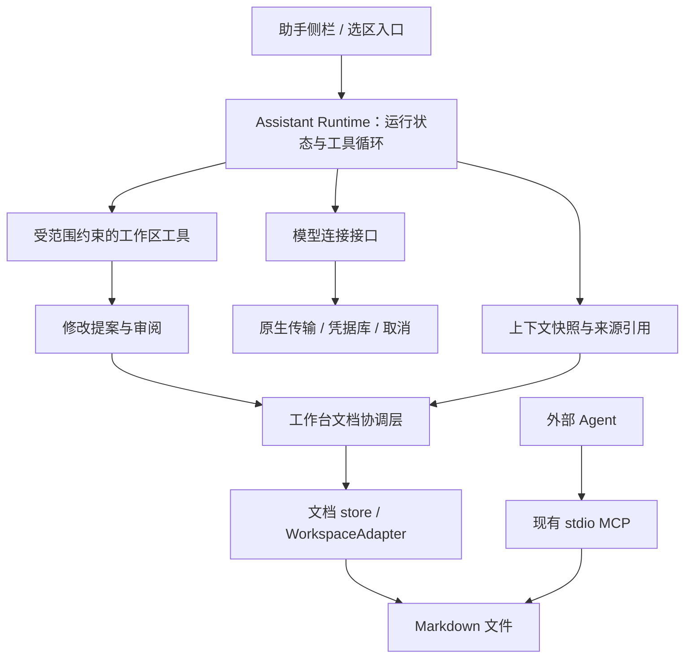

# AI / LLM 共同工作规划

状态：本地 BYOK 助手已实现，本机协议及桌面端到端验收通过；真实模型质量待联调。日期：2026-10-01。

当前实现提供流式问答、参考文档和选区、来源引用、单项修改审阅与采纳、条件撤回、新文档建议、停止及会话恢复。经用户开启范围后，助手可以搜索并读取工作区 Markdown、提出工作区事件（包括可勾选任务）和新增关系。批注及文档讨论可转入助手，回答可填写为回复草稿；外部 MCP 可以提交待审阅的 Markdown 提案。

这些能力使用桌面原生传输和应用数据，浏览器演示仅提供明确标注的模拟响应。连接可选择 Responses、Chat Completions 或本机 CLI，模型在各个对话中选择；不能保证任意兼容服务接受所选协议及参数。文档修改可以发布到[建议编辑](suggesting.md)逐项审阅。Cloud 托管、持续后台任务、自动应用及会话自动保留期尚未实现。

使用入口见[助手使用说明](assistant.md)。本页保留总体路线，并区分现有实现与后续范围。

本文依据当前工作树规划，包括仍在开发中的批注与讨论代码；这些代码不代表已发布能力。产品边界沿用[聊天与助手](chat-and-assistant.md)、[架构](architecture.md)和[许可与范围](license.md)。

## 1. 产品目标与首版选择

让人在阅读和编辑同一份 Markdown 时，可以请助手理解材料、讨论问题、提出改动，并把确认后的结果安全地写回。用户始终能看到助手读过哪些内容、准备改哪里，以及实际保存了什么。

已确认的首阶段方向是 Tano 内置助手：阅读笔记、讨论并提出修改；接入方式为用户填写自己的 API 密钥，直连模型服务（BYOK），无需 Tano 账号。建议采用「桌面内置助手优先、外部 Agent 持续兼容」路线。本地模型作为后续适配目标。模型调用、普通账号聊天、网络协作分别演进。

首版的完整体验：

1. 用户在文档中选中文字，或将当前文档加入助手上下文。
2. 用户输入「梳理这一节的论证，保留原有引用」，界面显示将使用的文档、选区和模型连接。
3. 助手可以回答问题，也可以生成一项修改建议；回答附带可打开的来源引用。
4. 用户继续编辑文档，助手在侧栏流式生成，不占用正文输入。
5. 用户查看修改前后，选择「应用修改」或「放弃」。若期间发生编辑，先合并并更新预览；不能合并时保留现有内容和建议。
6. 应用成功后显示实际差异和结果；需要撤回时，生成针对当前版本的反向修改。

当前版本支持当前文档、选区和用户明确添加的参考文档；每项建议只修改一个文档，也可建议创建一个 Markdown 文件。一轮任务最多提出 20 项建议，分别审阅和记录结果，不提供跨文件事务或整批回滚。获得对象读取授权后，可新增事件、修改已有任务、调整负责人及维护已有关系；修改均基于读取快照、差异预览和用户确认。目录任务查询需同时获得检索与对象读取授权。

## 2. 当前基础与实际缺口

| 领域 | 当前工作树 | 需要补齐 |
| --- | --- | --- |
| 外部 Agent | [stdio MCP](../../apps/mcp/src/server.ts) 保留原四个工具，并增加稳定身份读取、提交提案、查询结果和规则读取 | 扩展到结构化对象提案；原四个直接写入工具仍由外部客户端负责授权 |
| 文档保存 | [工作区 store](../../packages/workbench/src/stores/workspace.ts) 已提供草稿快照、串行审阅、三方合并及条件写入 | 持续验证真实材料和外部进程竞争 |
| 合并与差异 | 已复用 [Markdown 三方合并](../../packages/markdown/src/index.ts) 与 [ChangeDiff](../../packages/workbench/src/components/ChangeDiff.vue)，实现状态、预览过期、去重和反向提案；文档建议支持逐项接受与拒绝 | 更复杂的语义冲突与跨结构依赖 |
| Agent 界面 | [AssistantPanel](../../packages/workbench/src/components/AssistantPanel.vue) 已提供会话、连接、来源、提案和停止；原 MCP 面板保留 | 更多供应商协议与参数设置 |
| 活动记录 | [原生活动读取](../../crates/tano-native/src/agent.rs) 展示 MCP 写入记录 | 内置助手的会话、运行、提案和写入结果关联 |
| 批注与讨论 | 已提供「请助手参与讨论」与回复草稿入口；发布仍是用户动作 | 专门的助手作者与讨论运行关系 |
| 原生连接 | 已提供 HTTP SSE、系统凭据库、取消、超时、用量与脱敏错误 | 真实模型质量评估、兼容服务实测 |
| Cloud 边界 | [Cloud Extension API](../cloud-extension.md) 承载可选产品能力 | 后续注入托管模型和协作能力；本地助手独立可用 |

目前 MCP 的 `expectedHash` 拒绝过期写入，由调用方重新读取和合并；它没有内置助手的审阅流程。现有活动记录中的 `prepared` 表示写入结果待核对，不能直接解释为「等待用户批准」。外部客户端名称也不是经过验证的人员或模型身份。

## 3. 界面与日常工作方式

助手使用独立侧栏，文档保持可见。可从文档工具栏、选区工具栏进入；有真实可用能力后再展示入口。现有 MCP 配置和活动保留为连接与记录功能。

侧栏包含四种信息：上下文引用、对话、当前任务进度、修改建议。界面使用「正在阅读」「正在生成」「待审阅」「已应用」「需要处理冲突」等具体状态。对话正文不是保存成功的依据，执行状态由宿主回执决定。

| 用户动作 | 助手行为 | 写入时机 |
| --- | --- | --- |
| 询问当前文档 | 使用选定快照回答，给出来源 | 不写文档 |
| 改写选区 | 生成基于原始 Markdown 的修改建议 | 用户采纳后 |
| 整理为新文档 | 生成标题、目标路径与正文预览 | 用户采纳后，以不覆盖方式创建 |
| 在批注中请求协助 | 复用同一运行时，携带该讨论和引用片段 | 回答可填为回复草稿；用户发布，正文修改单独采纳 |
| 从云端聊天发起任务 | 后续由明确用户动作创建助手任务 | 仍遵循助手授权与审阅规则 |

助手面板保留整项提案采纳；文档修改也可发布为独立修改项，在文档中逐项审阅。每次接受重新定位当前原文并协调草稿与磁盘，剩余建议按原基线重新映射；不直接按旧行号写入。已发布提案不能再次整篇应用。

## 4. 分层与代码归属

图中 MCP 保留独立文件通道；新增提案工具将不可变建议记录在工作区外的应用数据，助手导入后共享内置审阅协调入口。内置助手不启动本机 Node.js MCP 子进程。

建议的模块拆分：

| 位置 | 职责 |
| --- | --- |
| `packages/protocol/src/assistant.ts`，新增 | 会话、上下文、提案、运行事件、用量等可序列化契约 |
| `packages/workbench/src/assistant/engine.ts`、`structures.ts` | 不依赖 Vue 或 Tauri 的流解析、工具循环、预算、提案校验 |
| `packages/workbench/src/assistant/`，新增 | 当前实例的会话 store、上下文构建、提案协调与 UI |
| `packages/workbench/src/runtime.ts` | 注入可选助手能力；本地与 Cloud 可提供各自传输实现 |
| `crates/tano-native/src/assistant.rs` | 模型传输、系统凭据、运行取消、记录持久化、外部提案互通及宿主操作校验 |
| `apps/mcp/` | 维持现有外部接入；后续增加版本化的提案工具 |
| `Tano-cloud` | 托管模型网关、账号配额、计费、远程执行与聊天集成 |

实现保持上述依赖方向，运行时暂留在工作台目录，未单独拆包。编辑器只提供选区和内容能力，不直接调用模型；模型 SDK 不进入编辑器和协议包；本地核心不导入 Cloud 的账号、聊天或部署模块。

首版执行循环随当前工作台实例运行。关闭窗口会中止运行，重启后展示中断状态；后台常驻和自动恢复执行另行实现，不先引入守护进程。

## 5. 上下文与安全应用修改

### 上下文应对应用户看到的内容

构建上下文时优先读取当前编辑草稿，保留生成时的不可变快照。记录工作区 UUID、文件短 ID、当时路径、内容 hash、来源为草稿还是磁盘，以及选区信息。未打开的文件通过存储适配器读取。

每个上下文项由宿主分配引用 ID。模型只能引用实际提供的条目；宿主校验后将其渲染为可点击来源。打开引用时以文件 ID 解析当前位置，并提示内容是否变化；路径和行号只作为展示信息。

选区同时记录来源模式、原文及前后文。富文本可见文字偏移不等于 Markdown 源码偏移，不能把批注的 `prose` 坐标直接当作源码补丁位置。首版必须验证选区到 Markdown 的映射；不能唯一定位时要求重新选择，或转为整篇建议。

默认只读取用户选定上下文。用户开启当前工作区检索后，可复用本地搜索并按需读取 Markdown 快照，显示实际来源；超过预算时拒绝进一步读取，不静默截断提案基线。真实材料上的检索质量仍需评估，再决定是否引入向量索引。索引属于可重建的应用数据。

工作区文档、附件、检索结果和工具返回均视为内容。里面的指令不能扩大读取范围、变更模型地址或授予写入权限。

### 提案必须有可验证的基线

建议契约至少包含以下字段组：

| 字段组 | 内容与用途 |
| --- | --- |
| 身份 | `proposalId`、版本、`runId`、工作区 UUID；更新时带文件短 ID，新建时带期望路径 |
| 原始输入 | 生成时的完整文档快照及 hash；取自编辑草稿时还保留其磁盘基线 |
| 建议 | 新正文或经过校验的局部替换，以及给用户看的修改理由 |
| 审阅 | 用户当前预览版本、预览的 before/after hash、已采纳提案版本 |
| 结果 | 实际提交前后 hash、状态、错误与可供核对的内容证据 |

模型可以提出文本替换或新内容，但不能自行提供可信的基线、授权或提交回执。这些信息必须由宿主从真实读取中构建。局部替换首先在不可变快照上验证，再计算建议全文；不能全局替换所有同名片段。

建议的应用流程：

1. 校验提案版本、范围和当前工作区会话；以文件 ID 解析目标。工作区切换、文件消失、只读状态或目标身份变化时停止应用。
2. 在工作台串行协调入口中取得最新草稿和磁盘版本。先按现有基线协调人类草稿与外部修改；已有冲突时保留草稿、磁盘和 AI 建议，停止写入。
3. 将生成基线、AI 建议、最新正文进行三方合并。独立修改可合并，重叠修改进入冲突审阅。
4. 若预览后正文改变，更新差异并让用户针对新的预览采纳；不将旧的采纳记录用于新的建议内容。正常无变化的采纳直接应用，不再二次确认。
5. 提交时再核对预览所用草稿版本与磁盘 hash。经文档协调层调用条件写入；期间新出现的人类输入继续保留，不能被保存回执覆盖。
6. 只有存储回执确认成功才显示「已应用」。重复点击、重复工具响应、断线重试使用相同操作 ID，不能重复创建或重复写入。

当前实现已为这条流程新增专用协调方法。不能仅调用 `editDocument()` 后依赖 600 ms 自动保存，也不能把 `flush() === true` 当成没有冲突；当前 `flush()` 允许已保留副本的冲突状态通过。

三方合并复用现有保守的行级算法；它不保证语义正确。预览与条件写入也不提供对任意外部进程的绝对原子 CAS：当前实现的最后一次 hash 复查到文件发布之间仍有短暂竞争窗口，需要如实保留这一边界。Tano 自有写入通道的锁与协调一致性应在第一阶段专门验证。

撤回使用实际已应用版本生成反向提案，再与当前内容合并；不能直接用旧文件覆盖后续编辑。多文件阶段逐项记录结果，遇错停止并保留已成功项，除非实现了事务机制，否则不承诺跨文件原子回滚。

## 6. 执行、权限与持久化

### 运行状态和工具范围

当前消息运行状态为 `running / completed / cancelled / failed / interrupted`；生成完成不表示建议已写入。提案使用独立状态 `ready / applying / applied / rejected / conflicted / unknown`。未来后台队列再引入 queued 等状态。

停止操作取消模型传输并阻止新的工具调用。若文件提交已开始，需要核对结果后再标记已应用或待核对，不能用「已取消」暗示已经回滚。写入结果未知时通过操作记录与当前文件核对，不能盲目重放。

默认向模型暴露提出文档修改和新建文档的能力；检索及工作区对象读取与建议分别由用户开启。真正的 `apply` 由用户采纳触发，模型不直接持有完整的 `WorkspaceAdapter`。每次运行设置工具轮次、读取字节数、输出 token、超时等上限，并显示供应商实际返回的用量；不虚构费用或缺失的用量。

范围约束在宿主执行工具时检查，不只写入提示词。一次任务选定的文档允许持续读取，正常采纳不重复弹出权限窗口；请求扩大读取范围时才增加可见授权动作。授权绑定工作区、本机打开会话和能力；本机路径用于验证打开的根目录，不替代稳定身份。关闭或切换工作区后拒绝迟到事件。

删除、移动、终端命令、任意网络请求与外部发送不进入首版工具集。后续确有场景时分别定义能力与授权；本地助手的权限约束不会自动约束现有外部 MCP 客户端或普通外部文件进程。

### 模型连接

已确定首版采用用户自带 API 密钥，桌面直接连接模型服务。先提供一种经过验证的真实 API 连接，通过系统凭据库存储用户密钥；模型 ID 与供应商不进入核心数据模型的业务判断。连接设置保存名称、服务地址、凭据引用、工具开关及输出上限；模型在对话中选择，随会话保存，每次请求明确携带。原生层读取连接的 `/models` 列表，列表不可用时支持在对话中手动指定。统一接口覆盖文本流、结构化工具调用、取消、错误和用量；各适配器声明实际能力，不假设不同服务的兼容接口行为完全一致。

厂商和具体模型在真实凭据、预算与材料明确后选定；模型选型不阻塞提案与并发写入机制的开发。前期可使用可重复的假传输验证状态机；真实联调再覆盖超时、限流、断流和无效工具参数。缺少工具调用能力的模型只提供问答，不伪造自动执行能力。

密钥输入后直接交给原生凭据层，持久化 store 与日志不保留明文，读取设置时只返回是否已配置。模型网络请求由原生传输执行，校验目标地址和重定向，避免凭据发送到其他主机。远程连接使用 HTTPS；本机服务连接单独标识。

浏览器演示先提供明确标注的模拟运行和提案演示，不内置真实密钥。在线产品后续通过 Cloud 注入托管连接。未接入真实模型的界面明确显示未接入，模拟测试不能当作模型质量验收。

### 数据放在哪里

| 数据 | 位置与规则 |
| --- | --- |
| 最终文档与用户另存的助手结果 | 普通 Markdown，仍是内容事实源 |
| 会话、运行事件、提案快照、恢复记录和用量 | 工作区外的应用数据；按工作区 UUID 和稳定的本机挂载记录隔离，重开后可恢复 |
| 模型连接设置 | 应用数据，仅存非敏感配置和凭据引用 |
| API 密钥 | 系统凭据库 |
| 可移植的工作区助手规则 | `.tano/rules/assistant.md`，已纳入 TS 与原生路径协议 |
| 批注、对象与关系 | 后续通过已有结构化接口写入 `.tano/` 对应位置 |

本机挂载记录用于区分同一 UUID 的不同本地副本；每次打开另有临时会话标识，阻止旧运行跨会话继续写入。恢复历史不等于恢复执行授权。

运行数据可能包含原文片段，应提供删除会话及保留期设置；待审阅和待核对的提案不能被当作普通缓存静默清除。日志默认记录状态、时延和用量，不复制完整正文和密钥。

向导现在创建 `.tano/rules/assistant.md`；已有用户 `AGENTS.md` 兼容读取，不自动移动或覆盖。规则路径已扩展 `isWorkspaceDataPath`、原生文件和目录允许列表及路径测试。工作区规则只能收紧行为约束，不能授予更大权限。外部 Agent 须自行支持该规则路径。

`.tano/config.json` 继续只保存便携工作区身份；不加入模型配置、会话、密钥或运行状态。

## 7. 实施阶段与验收

以下是按依赖顺序的交付切片，不是已经承诺的工期。

| 阶段 | 可交付结果 | 完成条件 |
| --- | --- | --- |
| P0：协议与修改闭环 | 上下文快照、单文档提案、差异审阅、应用与条件撤回；使用假传输 | 用户、外部编辑器与助手交错修改时，无静默丢失；重复应用与中断可核对 |
| P1：首个真实助手 | 桌面连接设置、流式问答、来源引用、选区改写、建议新文档、停止和恢复展示 | 配置一个真实连接即可完成首版场景；密钥不落工作区；结果状态与文件一致 |
| P2：跨文档工作 | 工作区搜索、范围内按需读取、多文件提案、按项结果 | 多文档问答可追溯；部分失败不重复成功项；预算超限可停止 |
| P3：工作区协作 | 批注入口、事件和任务建议、关系操作、外部 MCP 提案互通 | 使用现有对象校验与合并；范围和来源明确，个人计划与工作区计划严格区分 |
| P4：Cloud 与持续任务 | 托管连接、账号配额、聊天转任务、多人协作桥接、后台执行 | 在 Cloud 独立实现和验收；本地 MIT Core 仍能单独构建使用 |

P0 可先拆为两个逻辑提交：助手协议与确定性状态机；工作台提案审阅与并发保存协调。P1 再依次交付原生传输与凭据、助手侧栏与选区入口、真实模型联调。每个提交都有独立验收结果，避免先建设覆盖所有供应商的框架。

需要覆盖的行为：

- 人编辑第一段、助手改第三段可以合并；双方改同一段保留双方内容并显示冲突。
- 生成时存在未保存草稿，生成期间继续输入，预览后继续输入，保存回执到达前继续输入，均不丢字。
- 文档被移动后按文件 ID 找到；被删除、同路径重建、工作区切换或根目录被替换后不会写错文件。
- 重复文本中的选区唯一定位；富文本与源码两种模式下保留 YAML、引用、代码块和附件路径。
- 停止、重复提交、断流、写入后回执丢失、应用重启，均可区分未执行、已执行与待核对。
- 文档中的越权指令不会改变工具范围；符号链接、路径穿越与只读工作区沿用现有边界。
- 模型用量缺失、引用无效、工具参数错误、限流和凭据不可用时给出可操作错误。
- 已由 Cloud `editing` 会话管理的文档，首版最多提供获准快照的只读问答；未提供协作应用桥接前拒绝应用修改，不能绕过活动协作会话直接写盘。

实现阶段执行 `npm run check`；涉及原生存储、凭据与传输时补充对应原生测试、`npm run test:native` 和 Rust 格式化；修改 MCP 时补充 `npm run mcp:smoke`。[真实模型验收](assistant-evaluation.md) 已提供六个固定中文任务、离线结构检查、人工评分标准与耗时用量记录。连接配置后再评估来源正确性、引用保留、改写质量、响应时延和用量，记录模型与连接版本，不能以构建通过代替产品验收。

## 8. 后续需要明确的产品选择

内置助手与用户自带模型连接已确认，修改先审阅已落实。P0 的并发保存和状态恢复已有自动测试；真实连接及模型质量仍需按固定材料验收。P2 提供授权检索和逐项提案；P3 提供讨论草稿、事件创建、任务更新、负责人调整、关系维护及外部 Markdown 提案互通。P4 的托管模型与后台能力仍属独立 Cloud 路线。

需要在实现对应阶段前确定：首个真实服务与可用凭据、主要场景偏写作还是资料整理，以及日后本机模型的优先级、是否允许用户对限定范围开启自动应用。首版不依赖这些后续能力；具体模型性能和费用需要实测，本文不预设结论。配置密钥通过应用设置完成，不要求用户将密钥写进文档或开发讨论。
