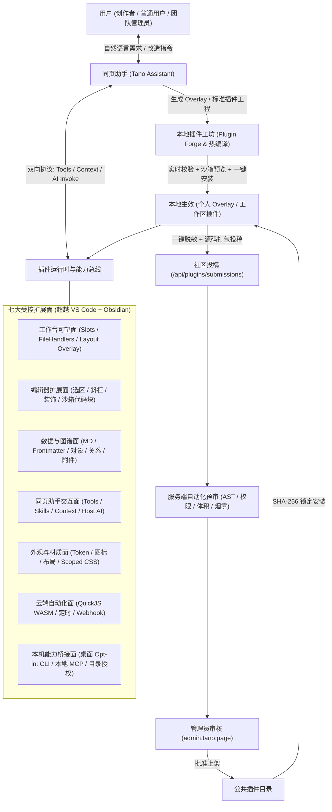
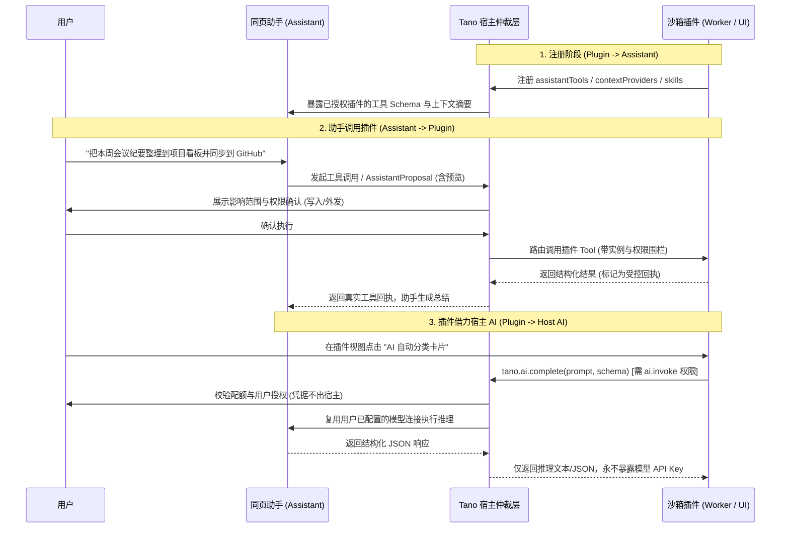
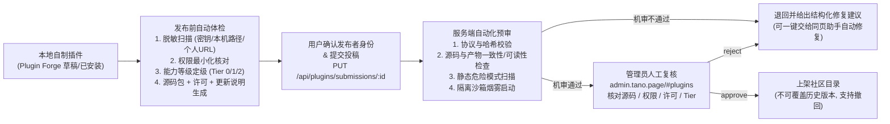

# Tano 下一代插件系统与 AI 可塑软件蓝图

> **愿景定位**：让 Tano 的插件自由度超越 **Obsidian** 与 **VS Code**，同时不重蹈 Obsidian 的“无隔离/易碎”与 VS Code 的“锁死壳层/无协作自动化”覆辙；并与 **同页助手（Tano Assistant）** 深度融合，让每个用户都能通过对话**本地改造软件、制作专属插件、并一键投稿经平台审核上架社区**。
>
> 本文档为长期架构蓝图。现有已实现协议与运行约束见 [插件开发与工作区管理](plugins.md)、[插件 API 参考](plugin-api.md)、[主题插件](theme-plugins.md) 与 [插件目录与发布](plugin-catalog.md)。

---

## 1. 第一性原理：如何同时超越 Obsidian 与 VS Code？

Obsidian 与 VS Code 代表了过去十年软件扩展性的两个极端，但各自有结构性天花板：

| 维度 | Obsidian 的天花板 | VS Code 的天花板 | Tano 的破局路径 |
| :--- | :--- | :--- | :--- |
| **安全与多端** | 主线程直接 `eval`，可任意改 DOM / 调 Node；无法安全跑在 Web、移动端与多人协作工作区 | Extension Host 有完整 Node/FS 权限，无法做到多租户零信任与服务端后台运行 | **分层信任（Tier 0–3）**：默认全沙箱跨端安全，仅在本地桌面显式 Opt-in 开放本机高权限 |
| **软件可塑性** | 靠黑客式 Monkey-Patch 改界面，官方小版本更新即大面积崩溃 | 明确禁止插件修改工作台核心布局、标题栏、壳层编排与自定义组件 | **显式可塑槽位 + 个人 Overlay 层**：把“改造软件”协议化，升级不碎、安全模式一键回退 |
| **内容与语义** | 只有文件层，缺乏原生一等对象/关系图谱与三方合并协作 | 面向代码而非知识库，无原生的文件+对象双层语义与云端自动化 | **Markdown 事实源 + 语义对象/关系 + 协作合并 + 云端自动化**统一纳入插件契约 |
| **插件生产方式** | 纯人工写代码、维护成本高，普通用户只能做消费者 | 门槛更高，需完整本地工程环境与打包发布流程 | **AI 原生共创（Plugin Forge）**：同页助手直接本地改造、实时造插件、自动体检并衔接审核发布 |

**核心架构原则（不可妥协的不变量）**：
1. **改造即插件（Modification-as-a-Plugin）**：同页助手绝不直接篡改 Tano 安装包二进制或核心源码；一切本地软件改造都沉淀为**可审计、可版本化、可一键关闭/回滚、可分享的 Overlay 或标准插件**。
2. **Markdown 仍是唯一内容事实源**：任何编辑器卡片、画板或 AI 产物，落盘数据仍遵循普通工作区文件与 `.tano/` 语义契约，停用或卸载插件永不丢失用户内容。
3. **能力显式声明、信任按层隔离**：高自由度 ≠ 无边界；能力越强，授权粒度越细、生效范围越明确（个人设备 vs 协作工作区 vs 公共目录）。

### 总体生态架构图

---

## 2. 分层信任、跨端支持与双层作用域

要在安全与自由度之间打破二元对立，插件和本地改造按 **4 个信任层级** 治理：

| 层级 | 名称 | 自由度范围 | 运行边界 | 适用环境与分发策略 |
| :--- | :--- | :--- | :--- | :--- |
| **Tier 0** | **纯声明式扩展与微调** | 主题配色/图标/形态、对象与关系 Schema、数据表模板、快捷键重映射、界面元素显隐与侧栏重排（Overlay JSON） | **零脚本执行**，纯白名单数据校验 | 全平台（Web/Desktop/Mobile）、可安全随工作区同步、**无需代码授权**、直接可上架社区目录 |
| **Tier 1** | **标准沙箱插件**（社区主流） | 全部工作区数据/Frontmatter/附件读写、编辑器选区/斜杠/行内装饰/沙箱代码块、自定义文件编辑器（`fileHandlers`）、全高视图与工作台槽位、同页助手双向 Tool/Context/AI 调用、凭据代理网络、云端自动化 | 逻辑在 Worker 沙箱、界面在双层 opaque iframe、后台在 QuickJS/WASM；**无宿主 DOM、无明文凭据、无本机命令** | 全平台通用、支持团队工作区 SHA-256 锁定分发、**社区插件市场标准上架级别** |
| **Tier 2** | **工作台深度可塑层**（Malleable Shell） | 替换或重组工作台区域（自定义欢迎页、自定义侧栏壳层、自定义文档页眉/页脚/大纲器、自定义状态栏布局、受控 Scoped CSS 覆盖层、跨插件命令编排宏） | 仍在声明式 Slot + 隔离渲染边界内运行，通过宿主状态机驱动，**安全模式启动一键屏蔽**；不支持修改宿主安全提示与授权弹窗 DOM | 支持桌面与 Web；个人级默认仅本设备生效；工作区级需管理员显式启用；上架目录需人工重点复核兼容性 |
| **Tier 3** | **本机特权插件**（Local Native / Super-Plugin） | 桌面端超越 Obsidian 的终极自由度：注册本机 MCP Server、受控调用白名单外部 CLI/脚本、访问用户显式授权的工作区外目录、系统级自动化钩子 | **仅限本地桌面（Tauri/Rust 仲裁）**，用户逐项开启“本机高权限模式”并按路径/命令白名单授权；不可读写应用凭据库 | **严格绑定当前设备**，绝不随 `.tano/plugins.tano.json` 自动同步给团队成员；公共目录默认不收录二进制/任意命令型 Tier 3，仅允许经严格开源审计的独立“本机高权限”频道或本机私有导入 |

### 2.1 跨端支持矩阵（浏览器端 vs 桌面端）

Tano 的插件运行时采用 **Web-first** 设计（Worker + 双层 iframe 沙箱 + IndexedDB 缓存），**并非仅限桌面端使用**。90% 以上的能力在浏览器端与桌面端完全通用，仅涉及操作系统底层的 Tier 3 严格限定在桌面本地模式：

| 能力 / 插件层级 | 浏览器端（在线工作区 / Web） | 桌面端（在线工作区） | 桌面端（本地工作区） |
| :--- | :---: | :---: | :---: |
| **Tier 0：声明式扩展与 L1 软件微调**（主题/图标/布局/对象/关系/界面编排 Overlay） | 完全支持 | 完全支持 | 完全支持 |
| **Tier 1：标准沙箱插件**（`fileHandlers`、编辑器选区/斜杠/代码块渲染、工作台槽位、同页助手双向 Tool/AI） | **完全支持** | 完全支持 | 完全支持 |
| **Tier 1 云端自动化**（定时/Webhook，QuickJS WASM） | **完全支持**（云端执行） | 完全支持（云端执行） | 不支持（无服务端队列） |
| **Tier 1 服务凭据连接**（API Key / OAuth） | **支持**（服务端加密代理） | 支持（服务端加密代理） | 支持（系统凭据库） |
| **Tier 2：工作台深度可塑**（自定义首页/壳层区域/Scoped CSS） | **完全支持** | 完全支持 | 完全支持 |
| **同页助手造插件（Plugin Forge）** | **支持轻量场景**（`esbuild-wasm` 编译纯 TS/JS/UI；重型 npm 依赖受限） | **完整支持**（内置轻量打包器，支持完整 npm 依赖） | **完整支持** |
| **Tier 3：本机特权插件**（本地 CLI/脚本、本地 MCP Server、工作区外目录访问） | **不支持**（浏览器物理沙箱限制） | **不支持**（禁止在线工作区借权本机） | **仅此模式支持**（显式 Opt-in） |

清单通过 `platforms?: ("web" | "desktop-local" | "desktop-online" | "mobile")[]` 显式声明兼容环境；在不支持的环境（例如浏览器中打开依赖 Tier 3 的插件）会给出清晰的平台提示，而不静默报错。

### 2.2 双层作用域体系（用户级 + 工作区级）

为解决当前所有第三方插件（包括主题、图标与个人效率工具）均强绑定单个工作区导致“切换或新建工作区即失效”的体验割裂，插件安装与生命周期升级为**「用户/个人级（User Scope）+ 工作区级（Workspace Scope）」双层作用域**：

| 作用域 | 存放位置 | 典型插件与改造 | 生效范围与同步方式 |
| :--- | :--- | :--- | :--- |
| **用户 / 个人级（User / Profile Scope）** | 应用数据（本地）或账号云端配置同步（在线账号），**不写入 `.tano/plugins.tano.json`** | • **本地软件改造**（L1 Overlay / Tier 2 壳层定制） • 主题、图标、布局插件 • 通用个人效率工具（番茄钟、字数状态栏、翻译/润色助手） • 用户自制的个人全局插件 • 桌面本机 **Tier 3** 插件（强制仅当前设备，不云同步） | 默认在用户打开的所有工作区生效，切换或新建工作区不丢失 |
| **工作区级（Workspace Scope）** | 继续保存在工作区的 `.tano/plugins.tano.json` | • **与工作区内容语义强绑定的插件**：自定义 `objectTypes` / `relationTypes`（如科研论文、项目看板） • 团队必需/推荐的格式编辑器与协作插件 • 工作区级共享设置与云端后台自动化任务 | 跟随工作区同步，保证团队成员打开同一工作区看到一致的语义结构与规则 |

**双层作用域的 3 条安全与仲裁铁律**：
1. **数据访问权仍按工作区收敛（防越权）**：用户级的**纯外观与 L1 界面改造**可无缝跨工作区生效；但用户级的**代码插件若需读写文档、对象或附件**，进入工作区时受目标工作区权限策略约束——团队管理员可配置策略限制未列白名单的个人代码插件读取机密工作区正文；普通个人工作区支持“允许此个人插件访问我的全部个人工作区”的便捷授权。
2. **同 ID 冲突以工作区锁定版本优先**：同一插件 ID 同时存在于用户级与工作区级时，进入该工作区仅运行工作区规则锁定的版本（避免双实例冲突），离开该工作区后自动恢复用户级版本。
3. **语义与自动化严格不串区**：工作区级声明的 `objectTypes`、`relationTypes` 与云端 `automations` 仅作用于所属工作区，绝不污染其他工作区。

---

## 3. 超越 VS Code 与 Obsidian 的七大扩展面设计

基于当前协议与 SDK 实现（[extensions.ts](../../packages/protocol/src/extensions.ts)、[plugin-sdk.ts](../../packages/workbench/src/plugins/plugin-sdk.ts)），将扩展能力系统性演进为七大扩展面：

### 3.1 工作台可塑面（彻底消灭硬编码特权，超越 VS Code 壳层限制）
- **`fileHandlers`（文件打开器协议）**：正式替代工作台对 `excalidraw`、`presentation-preview`、`word-preview` 的硬编码路由与全高样式特判。清单可声明：
  - `extensions` / `patterns`：匹配扩展名或后缀模式（如 `.excalidraw.md`、`.pptx`、`.docx`）
  - `mode`：`'preview' | 'editor'`（预览附件或接管编辑 Markdown/自定义格式）
  - `viewId`、`command` 与视图布局属性 `layout: 'fill' | 'contained'`（解决第三方 `tab` 视图无法全高铺满的问题）
  - 优先级与冲突策略：用户/工作区可为每种后缀指定默认打开器，右键始终保留“用默认 Markdown 源码打开”的逃生口。
- **全工作台 Slot 槽位体系**：在现有 `panel / tab / sidebar / settings` 基础上，新增：
  - `statusBar`：底部状态栏纯文本/图标/悬停提示/点击命令（字数、阅读时长、番茄钟、同步状态）
  - `documentSidebar`：跟随当前活动文档动态刷新的右侧检查器（反向链接分析、文献卡片、大纲增强）
  - `documentHeader` / `documentFooter`：文档正文顶部/底部的受控隔离条（属性看板、关联任务摘要、审批状态条）
  - `homeTab` / `newTab`：可替换工作区首页或空白新标签页（Tier 2）
- **宿主托管轻量交互 UI（`tano.ui.*`）**：`ui.pick()`（QuickPick）、`ui.prompt()`（InputBox）、`ui.confirm()`、`ui.toast()`，让脚本型与 AI 生成的小插件无需手写一整套 iframe 前端。
- **工作台编排 Overlay（Tier 0 / Tier 2）**：允许用声明式 JSON 隐藏/重排侧栏项、固定常用命令到顶栏、组合多个视图为自定义工作台模式。

### 3.2 编辑器扩展面（安全复刻 Obsidian 核心生态，不暴露 ProseMirror 内部 DOM）
- **阶段 A — 编辑器上下文与事务操作**：
  - `editor.active()`：读取当前活动文档 ID、选区 UTF-16 范围与选中文本、光标所在块语义。
  - `editor.insert / replaceSelection`：通过现有协作安全事务（`applyPluginEdit`）在选区插入/替换内容，单步可撤销。
  - `slashCommands`：清单声明 `/` 斜杠命令触发项，复用 `commands` 调用链路。
  - `documents.frontmatter.read / update`：结构化读写 YAML frontmatter，解决富文本打开态下无法安全改属性的缺口。
- **阶段 B — 沙箱化嵌入式渲染与装饰**：
  - **Code Block Renderer（隔离代码块渲染器）**：清单声明接管特定围栏语言（如图表、看板、查询块），宿主在文档流内嵌复用现有双层沙箱 iframe 渲染卡片；只接收代码块源码、当前文档元数据与主题快照，支持按需回写代码块内容。
  - **声明式行内装饰与块级微件（Decorations & Block Badges）**：Worker 计算偏移范围与纯数据描述（高亮色 token、行尾徽章、悬停纯文本/Markdown 提示、点击触发命令），由宿主 ProseMirror 统一安全绘制。

### 3.3 数据与语义图谱面（发挥 Tano 独有优势，同时收紧作用域）
- **补齐文件操作闭环（显式独立高危权限）**：
  - `attachments.write`：受限写入工作区附件（限定目录前缀、白名单后缀与单文件上限）。
  - `documents.trash` / `documents.move`：移入工作区回收站（可恢复）与重命名，不提供不可逆静默硬删除。
- **路径前缀权限收敛（Path Scoping）**：参考现有 `connections.pathPrefix`，授权 `documents.read/write` 与后台自动化时，允许用户/管理员将插件限制在指定目录（例如 `日报/`、`论文/`）。
- **跨插件松耦合协作（不共享内存）**：
  - 允许插件在清单声明 `services`（公开可调用的无状态 RPC 契约 + JSON Schema）与可引用的公共 `objectTypes`。
  - 其他插件通过声明 `usesServices: [{ pluginId, service, optional }]` 经宿主消息总线调用，彻底避免 Obsidian 式全局内存强耦合。

### 3.4 协议底座、依赖与版本治理升级
1. **包格式演进 `packageVersion: 2`（确定性 ZIP 容器）**：
   - 将单文件 `.tano-plugin.json` 升级为确定性归档容器（保留 v1 向下兼容），分离 `manifest.json`、Worker JS、UI JS/CSS、自动化脚本与二进制资产（PNG/SVG/WASM/字体），对归档规范字节流计算 SHA-256。
   - 消除 JSON 转义与 base64 膨胀，同时将 2 MiB+ 的图标 PNG 资产彻底移出 `manifest`，把 `.tano/plugins.tano.json` 从 16 MiB 重新收紧回 **≤ 1 MiB**。
2. **宿主版本与能力协商**：
   - 清单新增 `engines: { tano: ">=0.15.0" }`、`apiVersion` 次版本能力声明与 `platforms`。
   - SDK 新增 `tano.hostInfo()`，返回宿主核心版本、平台模式、支持的扩展能力清单。
   - 社区目录支持 SemVer 预发布通道（`1.2.0-beta.1`）。
3. **标准化契约细节**：
   - **前台结构化错误码**：统一 `TanoPluginError { code, message, retryable? }`，与服务端自动化对齐。
   - **按需激活与优雅卸载**：引入 `activationEvents` 和 2 秒超时 `deactivate()`。
   - **配置表单化与多语言**：引入受限 JSON Schema `settingsSchema` 和 `nls` 多语言字典。
   - **独立开放开发者生态**：拆分发布独立的 `@tano.page/plugin-sdk`（所有公共类型收敛至 `@tano/protocol`）与独立 CLI `tano-plugin` + 官方 `manifest.schema.json`。

---

## 4. 核心差异化：同页助手 ↔ 插件双向交互协议

插件不再只是给人点按钮的工具，同时也是同页助手的能力肢体；同页助手也不只是聊天框，同时是所有插件的智能编排中枢。

### 4.1 方向 A：插件增强同页助手（Plugin → Assistant）
1. **`assistantTools`（插件工具贡献）**：清单声明工具名、描述、参数 JSON Schema、副作用等级（`read` / `write` / `external`）。写操作/外发工具强制接入现有 `AssistantProposal` 审阅与回执流（[assistant.ts](../../packages/protocol/src/assistant.ts)）。
2. **`assistantContextProviders`（领域上下文提供者）**：插件可注册 `@mention` 上下文源（如 `@board`、`@paper`），在对话时提供受字节上限控制的结构化摘要。
3. **`tano.ai`（宿主托管推理能力）**：新增独立权限 `ai.invoke`，插件调用 `tano.ai.complete / structured` 复用用户已配置的模型连接，密钥永远不进入插件沙箱。

### 4.2 方向 B：同页助手操控插件（Assistant → Plugin）
- 助手可通过只读反射接口发现当前工作区与用户级已启用插件的对象类型、命令、视图与 `assistantTools`，并通过提案流打开视图、触发命令或协同整理数据。

### 4.3 针对 AI 交互的专项安全护栏
- **防间接提示词注入**：插件返回上下文与外部数据在进入助手前包裹不可信数据边界标记；插件不能修改系统提示词，也不能静默批准 `AssistantProposal`。
- **防权限提升**：助手调用插件工具时，取“当前用户权限 ∩ 助手会话授权 ∩ 插件自身声明权限”的**交集**。

---

## 5. 同页助手“本地改造软件”与“造插件 → 审核发布”闭环

### 5.1 三档“本地改造软件”机制（Malleable Tano）

| 改造档位 | 典型用户指令 | 产物形态 | 生效速度与安全保障 |
| :--- | :--- | :--- | :--- |
| **L1：即时微调**（Overlay，Tier 0） | “把侧栏不用的入口隐藏，给论文目录换一个护眼纸感配色，加一个‘每周复盘’快捷按钮” | 用户/工作区级声明式 Overlay JSON（不写入核心安装包） | **毫秒级热生效**、零代码执行、变更 diff 可视化、随时一键撤回 |
| **L2：对话造功能插件**（Plugin Forge，Tier 1 / Tier 2） | “做一个番茄钟状态栏 + 结束自动追加到今日日记 + 周末生成折线图统计” | 独立标准插件工程，经内置构建器打包为标准 `.tano-plugin` | 沙箱内即时试运行与预览；安装前展示权限清单与变更摘要；支持多轮对话迭代与版本历史回滚 |
| **L3：本机深度改造**（Local Native，Tier 3，仅桌面本地） | “把本机 Zotero SQLite 和自定义 Python 脚本接进来，保存笔记自动同步引用” | 桌面本机高权限插件（带本机命令/目录白名单声明） | 需用户显式开启“本地高权限改造模式”；**强制 `local-only`** 不传播给团队；支持“安全模式启动（跳过全部本地改造）” |

### 5.2 本地插件工坊（Plugin Forge）工作流

同页助手在**应用数据目录的独立工坊空间（`plugin-forge/<draftId>/`）**完成开发，不污染用户工作区根目录：
1. **微规格卡确认**：明确功能范围、所需权限、涉及槽位/数据范围及所属 Tier。
2. **标准工程生成**：生成规范源码、最小化权限清单与基础测试。
3. **热编译与三道自动门禁**：协议 Schema 校验 → TypeScript 类型检查 → 权限与密钥/敏感路径静态扫描。
4. **沙箱实时试跑与自修复**：右侧隔离面板直接试用，运行日志回传给同页助手自动修复。
5. **一键落盘安装**：生成带 SHA-256 的标准包，支持装为用户级全局插件或当前工作区插件。

### 5.3 从“个人自制”到“社区发布 & 平台审核”全链路

直接对接在线产品的发布者身份、投稿接口（`PUT /api/plugins/submissions/:id`）与管理员审核工作台（见 [插件目录与发布](plugin-catalog.md)）：

**AI 时代插件市场 4 条审核治理红线**：
1. **禁止黑盒混淆代码投稿**：必须附带可读源码快照（或关联公开 Git 仓库特定 Commit）。
2. **隐私与凭据防泄露门禁**：发布前自动拦截含硬编码密钥、个人绝对路径、内网地址的投稿。
3. **透明标识与限流**：记录 `createdWithAssistant` 标志并设置单作者待审并发上限，避免批量低质投稿挤占审核资源。
4. **分级审核**：Tier 0 以自动校验为主；Tier 1/2 执行机审 + 人工源码与权限复核；Tier 3 不混入普通社区目录。

---

## 6. 分阶段演进路线图

| 阶段 | 核心目标 | 关键交付项 | 验收标志 |
| :--- | :--- | :--- | :--- |
| **Phase 0** 地基清债与协议规范化 | 消除架构债务，建立面向外部生态的规范底座与双层作用域基础 | • `fileHandlers` + `layout: 'fill'` 协议化，移除 3 个内置插件硬编码 • 图标 PNG 资产移出 `manifest`（`.tano/plugins.tano.json` 收紧回 ≤1 MiB） • 建立**用户级（User Scope）+ 工作区级（Workspace Scope）**双层插件注册与同 ID 冲突仲裁基础 • 新增 `engines.tano` / `platforms` / `hostInfo()` / 结构化错误码 / `settingsSchema` / `activationEvents` / `deactivate` • 独立发布 `@tano.page/plugin-sdk`、`manifest.schema.json` 与独立 CLI | 内置 `excalidraw`、`word-preview`、`presentation-preview` 完全通过通用协议运行；用户级主题与工具切工作区不丢失；旧宿主对新插件给出清晰升级提示 |
| **Phase 1** 编辑器与工作台表达力跃升 | 补齐知识库核心扩展面，追平并结构化超越 Obsidian 常用体验 | • 编辑器选区读取、光标事务插入、`slashCommands`、结构化 `frontmatter` API • 宿主托管交互：`ui.pick / prompt / confirm` • 新槽位：`statusBar`、`documentSidebar`、`documentHeader/Footer` • **沙箱代码块渲染器（Code Block View）** 与声明式行内装饰 • 目录路径权限收敛（`pathScopes`）、团队工作区对个人代码插件的访问策略，以及 `attachments.write` / `documents.trash` | 用标准 Tier 1 插件实现状态栏、嵌入式图表/查询代码块与文献斜杠命令，Web 与桌面通用，零宿主 DOM 侵入 |
| **Phase 2** 同页助手双向协议 | 打通插件与同页助手，建立 AI 原生差异化 | • 清单 `assistantTools` / `assistantContextProviders` / `@plugin` 上下文 • 助手发现并经 `AssistantProposal` 调用插件工具与视图 • 新增 `ai.invoke` 权限与 `tano.ai.complete / structured` 宿主托管推理 • 间接提示词注入标记与权限交集仲裁 | 用户可在对话中让同页助手驱动插件完成跨文档任务，插件可安全借用宿主模型而无密钥暴露 |
| **Phase 3** 本地改造软件 & Plugin Forge | 实现“对话即改造、对话造插件、一键投稿审核”闭环 | • **L1 个人 Overlay 层**（用户级跨工作区生效，支持工作区覆盖、一键撤销与安全模式） • **L2 Plugin Forge**：桌面端内置轻量打包器 + 浏览器端 `esbuild-wasm` 轻量编译、自动质检、沙箱实时预览与迭代修复 • 一键脱敏打包直连投稿接口 + 服务端自动化预审流水线 | 非编程用户通过对话在本地完成界面改造或造出带 UI 的实用插件并跨工作区使用；一键投稿经机审+人工审核上架社区目录 |
| **Phase 4** 容器升级与高阶自由度 | 突破包形态极限，释放桌面端终极自由度 | • `packageVersion: 2` 确定性 ZIP 容器（原生支持二进制/WASM/多资产） • 跨插件松耦合 `services` RPC 协作协议 • **Tier 2 工作台深度可塑**（自定义首页/壳层区域编排/受控 Scoped CSS，支持 Web 与桌面） • **Tier 3 桌面本机特权模式**（仅桌面本地显式 Opt-in：本地 MCP 桥接、白名单 CLI/目录授权，`local-only` 强隔离） | 大型富媒体/WASM 插件体积大幅缩减；桌面极客用户可无侵入地把本地工具链与自定义工作台深度接入 Tano，且安全模式随时一键回退 |

---

## 7. 实施进度与 Open-Core 边界落地（路线 A）

- **MIT `Tano`（公开底座与开发者生态）**：
  - [x] **Phase 0–2 & Phase 4 通用插件底座**：`fileHandlers`、`layout: 'fill'`、User/Workspace 双层作用域、`engines`/`platforms`/`hostInfo()`、结构化错误码、`settingsSchema`、`activationEvents`、`deactivate()`、外部化图标资产；宿主 UI 交互与状态栏、文档槽位、编辑器选区/斜杠命令/代码块渲染器/装饰器、`frontmatter`、`pathScopes`、`personalCodePlugins`、`attachments.write`、`documents.move/trash`；`assistantTools` / `assistantContextProviders` / `tano.ai` 双向协议；`packageVersion: 2` 确定性 ZIP 容器、`tano.assets.list/read`、CLI `--format zip`、跨插件 `services` RPC、`homeTab`/`newTab` 视图声明、官方 [manifest.schema.json](../../packages/protocol/manifest.schema.json)。
  - [x] **通用 Cloud Extension 注入钩子**：`WorkbenchExtensions` 仅暴露中立的 `regions['plugin-forge']`、`overlay`（只读壳层快照 + Safe Mode）与 `assistant`（外部扩展工具/提示词/提案执行）接口，不包含任何私有商业化实现。
- **私有 `Tano-cloud`（核心商业化与 AI 可塑软件产品层）**：
  - [x] **L1 / Tier 2 工作台可塑层 + L2 Plugin Forge + 统一静态体检**：完整迁入 `Tano-cloud/packages/cloud-contracts/src/malleable` 与 `packages/cloud-ui/src/malleable`（通过 Cloud Extension API 注入），并与服务端 `plugin-prereview.ts` 统一复用同一份 `auditPluginPackage()`（原 P1-5 已同步收口）。
  - [x] **Tier 3 桌面本机特权执行器**：Rust 命令（`local_privilege_exec_cli` / `local_privilege_read_file` / `local_privilege_mcp_http`）仅注册在私有桌面客户端 `Tano-cloud/apps/client/src-tauri`，不进入纯 MIT 本地版。
  - [ ] **Tano 助手插件编排与自动造软件引擎**：在私有 `Tano-cloud` 内基于 `WorkbenchExtensions.assistant` 与 `useMalleableStore` 持续演进。

